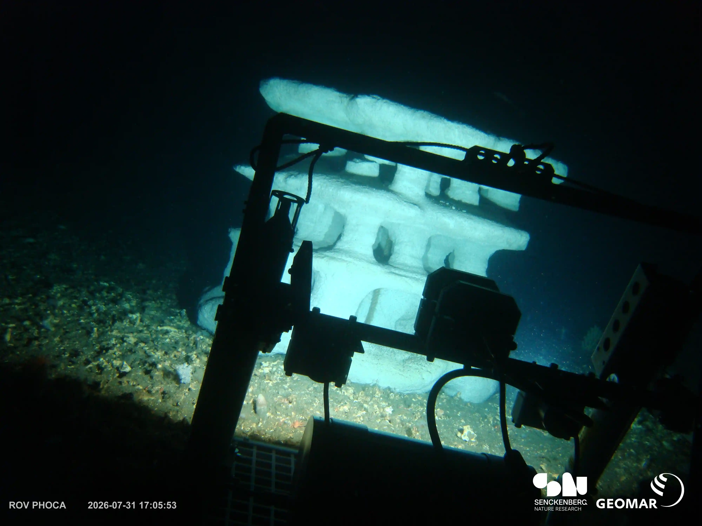
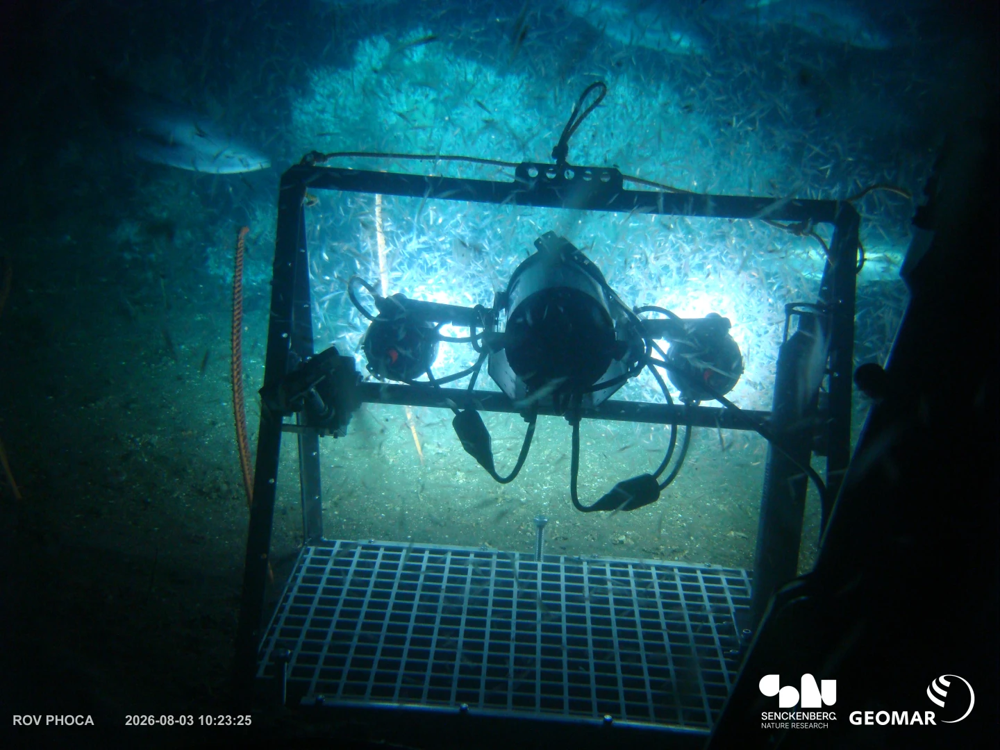
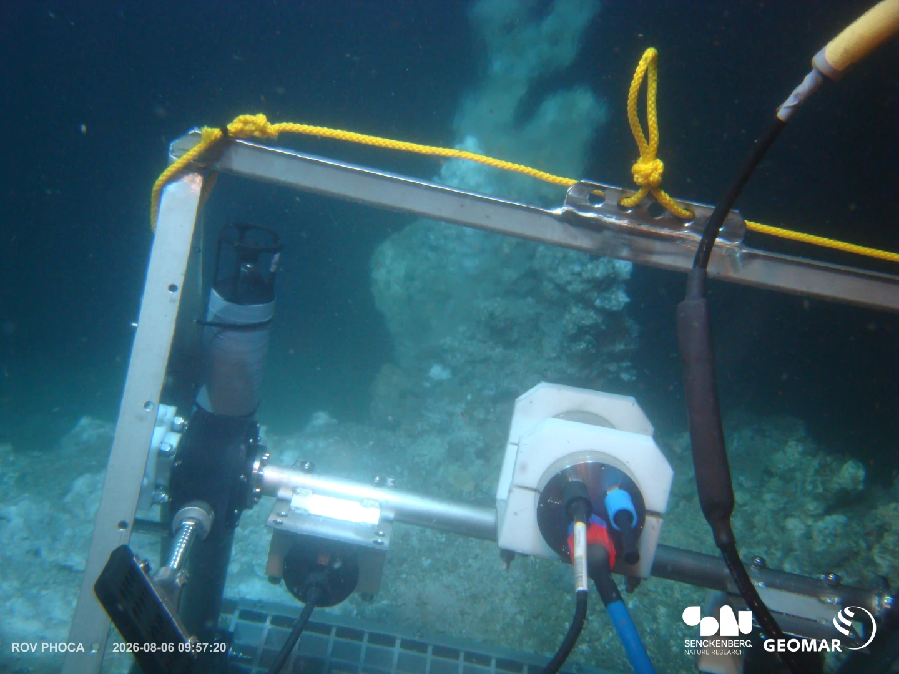

## <u>**A**</u> <u>**L**</u>ongterm <u>**O**</u>bservatory of the <u>**N**</u>orth Atlantic <u>**Gate**</u>way to the Arctic

ALONGate is an endorsed „UN decade action“ in cooperation with [DOOS](https://www.deepoceanobserving.org) and [Challenger 150](https://challenger150.world).

### Where is the Arctic Gateway? And Why?

The boundary region between Iceland, Norway, and Greenland acts as a corridor for specialized fauna to extreme environmental conditions moving through the North Atlantic Gateway to the Arctic Ocean. While a huge amount of biodiversity data is available for this area, the accumulation of data in more frequently sampled regions reveals sampling gaps, especially in deep and remote regions. The ALONGate project studies biodiversity across temporal and spatial gradients and connects data from previously established projects around Iceland (BIOICE: Benthic Invertebrates of Icelandic waters 1992 – 2004 and IceAGE: Icelandic marine Animals: Genetics and Ecology since 2011). 

## ALONGate Transects

Since 2023, annual Epibenthic Sledge (EBS) sampling in the HAUSGARTEN long-term ecological observatory established by the Alfred-Wegener-Institute contributes to a fundamental understanding of local warm and cold-water species distributions. Samples collected on a latitudinal Nord-South transect from Germany to the Fram Strait fill knowledge gaps for future observations of faunal community shifts towards northern waters. 

Additionally, two longitudinal transects, one from Greenland to Svalbard, one from Greenland to Norwegian Sea, are established. 

{width="500px"}

In-situ sampling of latitudinal and longitudinal deep-sea transects throughout the Gateway area is complemented with the deployment of long-term Benthic Lander Observatory Systems (BLOS) at critical intersecting nodes of the North-South and East-West transects, with a special focus on collecting image data of Vulnerable Marine Ecosystems (VMEs) like hydrothermal vents or cold-water coral (CWC) reefs across seasonal changes.

```{r}
#| output: false
devtools::load_all()
library(tidyverse)
library(leaflet)

blospos <- readr::read_delim("data/BLOS_pos.csv", delim = ",") %>% bind_cols(tibble(popup_html = c(
    "<div style='text-align:center;'><br><b>Artificial Reef</b><br>Six artificial coral reefs are dropped to the seafloor in collaboration with the HFRI from Iceland. The BLOS is monitoring one of them.</div>",
    "<div style='text-align:center;'><br><b>Cold Water Coral Reef</b><br>An intact, lively cold-water coral reef is chosen as a comparison to the artificial reef site.</div>",
    "<div style='text-align:center;'><br><b>Hydrothermal Vent</b><br>As delicate and vulnerable marine habitats, hydrothermal vents are on the top list as our BLOS target.</div>"
  )))
```

```{r}
#| fig-cap: "Deployed BLOS around Iceland - they are recording the seafloor as you look at this!"
leaflet(data = blospos, height = "550px", width = "100%") %>%
  addProviderTiles(providers$Esri.OceanBasemap) %>%
  addMarkers(
    ~lon, ~lat, 
    popup = ~popup_html
  )
```

Based on the compiled dataset of abiotic (bathymetric assessments, benthic oxygen uptake measurements, sediment samples) and biotic parameters (macrofauna samples, image data), a comprehensive comparison of macro- and megafauna community will contribute to a better understanding of benthic biodiversity and its driving parameters.


