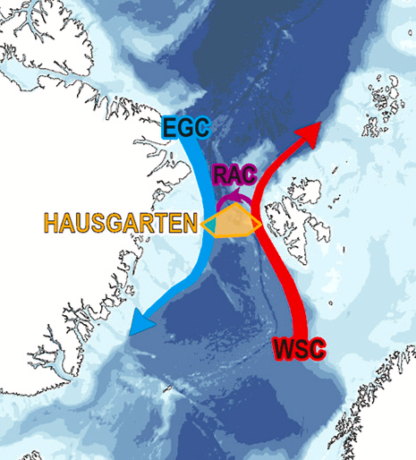

```{r}
#| output: false
devtools::load_all()
```

## 10 Years, 2,000+ Specimens, 1 Massive Catalogue

Our team focused on Cumaceans (also called "comma shrimp"), which are small crustaceans that live on and in the seafloor. Over the past 10 years, using gears like box corers and epibenthic sleds, we sampled deep-sea cumaceans living below 500 m depth at the Hausgarten LTER. Nearly 2200 individual specimens were examined for this study and we found:

- Cumacean diversity peaks between 1,200 and 1,500 meters deep
- Some species live much deeper than previously known, such as _Leucon acutirostris_ diving deeper for astonishing 3511 meters!
- We didn't find any species that only live below 2,000 meters. Instead, most of these species can thrive across a massive range of depths and are widespread across the Arctic.



## Up Close, In Detail

We were incredibly lucky to collect some rarely sampled, perfectly intact specimens. High-resolution images were capturered for the specimens, and for some of the species, these images are first of its kind.

```{r}
#| echo: false
insert_roulette("chapter/research/arctic-cumacean.yaml", "cumi-plates")
```

## The First Identification Key for Arctic Cumaceans

We’ve put together a comprehensive catalogue featuring simplified traditional and digital identification keys for 64 species of deep-sea Cumacea. Based on our models, this list is likely a complete representation of cumacean species in the Arctic deep sea. Because the Central Arctic Ocean has a low uniqueness of taxa, these identification keys can be reliably applied to the entire deep Arctic Ocean.

We also found some surprising physical traits that challenge how we previously classified certain species (especially in the families Diastylidae and Leuconidae), reminding us that the deep sea always has more to teach us. 

## Want to read more? 

The study has already been published on the journal "Deep Sea Research Part II", you can find out more about the biogeography and the identification key here:

::: {.disclaimer}

Uhlir, C., Bluhm, B. A., Brix, S., Dannheim, J., Górska, B., Heath, L., Kohlenbach, K., Pereira, E., Vedenin, A., Włodarska-Kowalczuk, M., & Gerken, S. (2026). A biogeographical inventory and the first taxonomic key to species of Cumacea (Crustacea: Peracarida) for the deep Arctic Ocean. Deep Sea Research Part II: Topical Studies in Oceanography, 227, 105612. [https://doi.org/10.1016/j.dsr2.2026.105612](https://doi.org/10.1016/j.dsr2.2026.105612)

:::

<hr>

Editor: Zhehao Hu, Carolin Uhlir