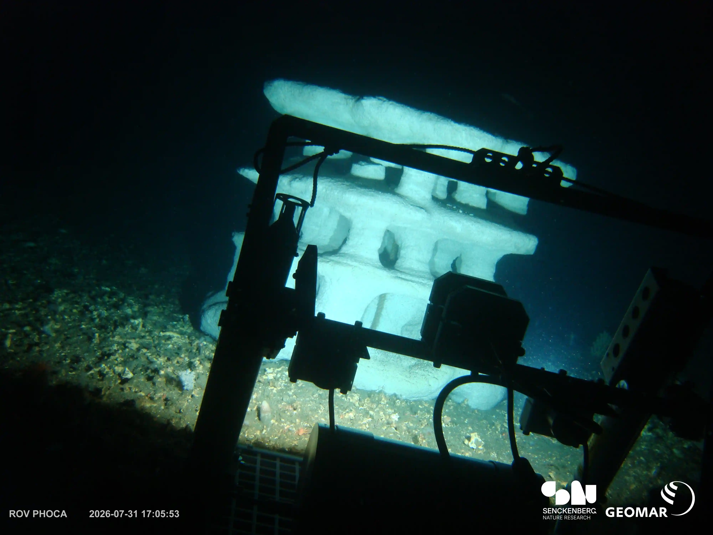
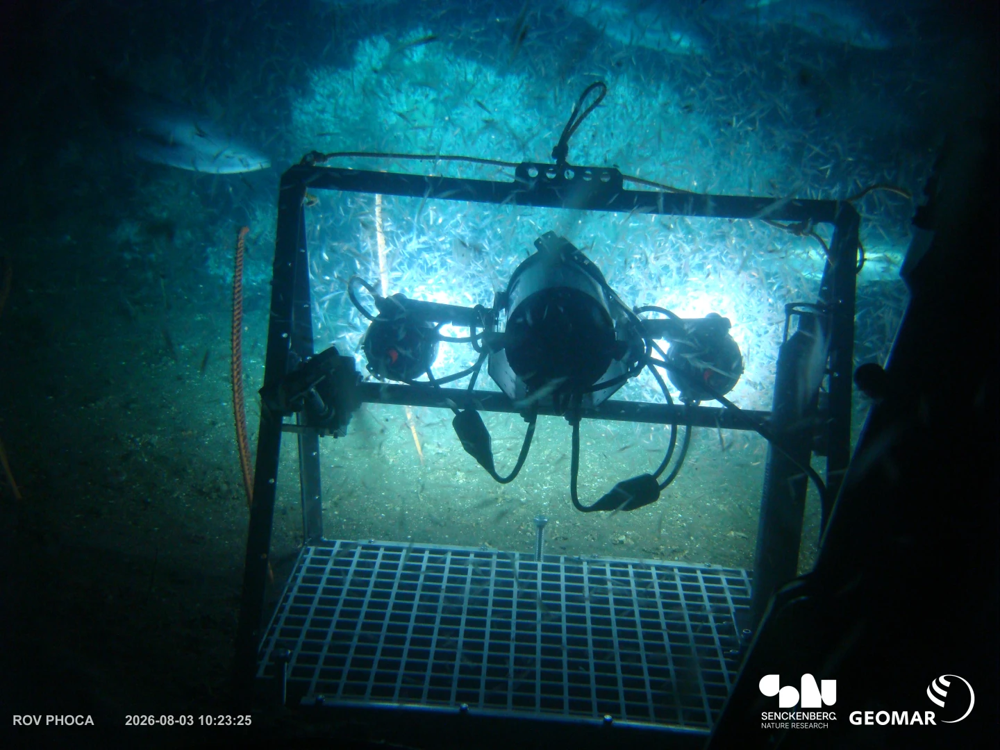
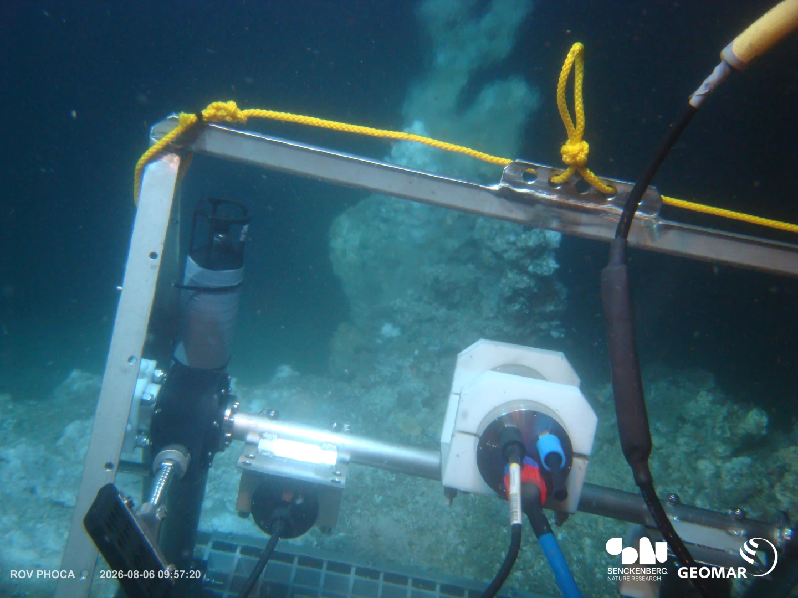

BLOS, stands for **Benthic Lander Observatory System**, is a customized system designed for data collection on the seafloor for a long period of time. Currently, three of such systems have been successfully deployed around Iceland during the MSM145 expedition in 2026. 

```{r}
#| output: false
devtools::load_all()
library(tidyverse)
library(leaflet)

blospos <- readr::read_delim("data/BLOS_pos.csv", delim = ",") %>% bind_cols(tibble(popup_html = c(
    "<div style='text-align:center;'><br><b>Artificial Reef</b><br>Six artificial coral reefs are dropped to the seafloor in collaboration with the HFRI from Iceland. The BLOS is monitoring one of them.</div>",
    "<div style='text-align:center;'><br><b>Cold Water Coral Reef</b><br>An intact, lively cold-water coral reef is chosen as a comparison to the artificial reef site.</div>",
    "<div style='text-align:center;'><br><b>Hydrothermal Vent</b><br>As delicate and vulnerable marine habitats, hydrothermal vents are on the top list as our BLOS target.</div>"
  )))
```

```{r}
#| fig-cap: "Deployed BLOS around Iceland - they are recording the seafloor as you look at this!"
leaflet(data = blospos, height = "550px", width = "100%") %>%
  addProviderTiles(providers$Esri.OceanBasemap) %>%
  addMarkers(
    ~lon, ~lat, 
    popup = ~popup_html
  )
```


## How are they built?

The conceptual design of our BLOS is based on the landers originally constructed by [IFREMER](https://www.ifremer.fr/fr). The physical structure consists of stainless steel frames to mount the individual components, including the camera, energy modules, the communication and storage systems. To ensure stable deployment and long-term durability in the extreme deep-sea environment, the equipment housings are constructed from titanium, a material known for its high resistance to immense pressure and saltwater corrosion. Once deployed, the system operates autonomously, programmed to record between 60 and 160 seconds of video every 12 hours. This continuous monitoring cycle will be carried out for an entire year until the next visit to retrieve the data. 

```{r}
insert_roulette("chapter/research/blos.yaml", "blos-1")
```

## Deployment and Recovery

Our BLOS are specifically designed for deployment and recovery using [GEOMAR's _ROV Phoca_](https://www.geomar.de/en/st/tlz/rovphoca/overview), allowing the entire system to be loaded onto the ROV's porch in one go and brought to the desired spot on the seafloor. To set up the systems efficiently, we use deep-sea Wi-Fi modules developed by IFREMER. 

The ROV and the BLOS each hold a Wi-Fi module that allows real-time data transmission from the BLOS computer to the ROV. Once the ROV reaches the deployment site, the positioning, lighting, and camera configuration are carried out by controlling the BLOS directly from the mission control onboard the vessel. When all settings are complete, the Wi-Fi module linking the BLOS is removed from the ROV container, detaching the two systems completely.

```{r}
insert_roulette("chapter/research/blos.yaml", "blos-2")
```

