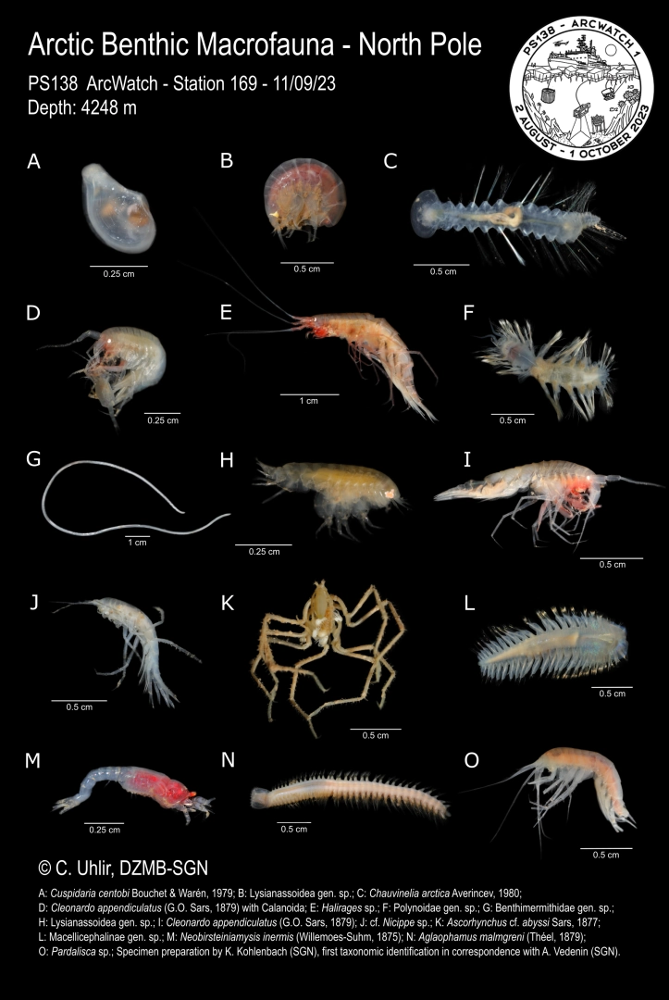

Macrobenthic life in the deep central Arctic Ocean is understudied despite its importance in biogeochemical cycling of carbon and nutrients. Here we focus on the Eurasian Basin that encompasses the Nansen and Amundsen Basins separated by the Gakkel Ridge. We compare macrofauna from a total of 24 box corer samples across 17 stations (3400 – 4400 m depth) in both basins sampled with RV Polarstern in 2012 and 2023. Over the last decades an increase in phytoplankton biomass at the shelves in the Arctic has been observed, but it is currently unknown if also the central Arctic is becoming more productive and if this potential surplus is translated at the benthos. 



We identified 63 taxa and, as is typical, major taxonomic groups included Polychaeta followed by Bivalvia and specifically in 2023, the brooding crustaceans Isopoda, Amphipoda, Tanaidacea in the Amundsen Basin. Macrofauna density and biomass did not differ significantly between basins or the years indicating no or weak dispersal limitation by the Gakkel Ridge, consistent with previous studies. However, the population of several species sampled in 2012 consisted mostly of adults, whereas in 2023 they were made up mostly by juveniles, indicating a different status of the ecosystem despite the same time of sampling. In 2023, lower bacterial abundances and lower food quality, indicated by the proportion of chlorophyll a to total chloroplastic pigments, was observed. This difference was especially pronounced in the Amundsen Basin, where a concurrent decrease in macrofauna biomass was observed. Interestingly, Hill diversity indices were higher in 2023 compared to 2012, mostly driven by the presence of many singleton species detected in 2023.

Our results suggest differences in cryo-pelagic-benthic coupling between the years with impacts on benthic life. However, macrofauna diversity, density and biomass varied strongly among stations, reflecting deep-sea patchiness and the need for increased sampling efforts. A clear reaction of the benthos to the changing Arctic could not be observed (yet). Regular sampling across seasons is needed to understand potential multiyear changes as the benthos might respond slower in comparison to surface water communities.

## Want to know more? 

Our PhD student, **Katharina Kohlenbach**, will give a presentation about this at the World Conference for Marine Biodiversity (WCMB): 

```{r}
#| output: false
library(tidyverse)
devtools::load_all()
```

```{r}
#| output: asis
forwardMsg("A decade apart: Comparison of macrobenthos across the Nansen and Amundsen Basin in the Arctic Ocean in 2012 and 2023")
```

- Time: **19.11 at 14:00**
- Session: **2.8**
- Venue: **Kamermuziekzaal, Squid room**


