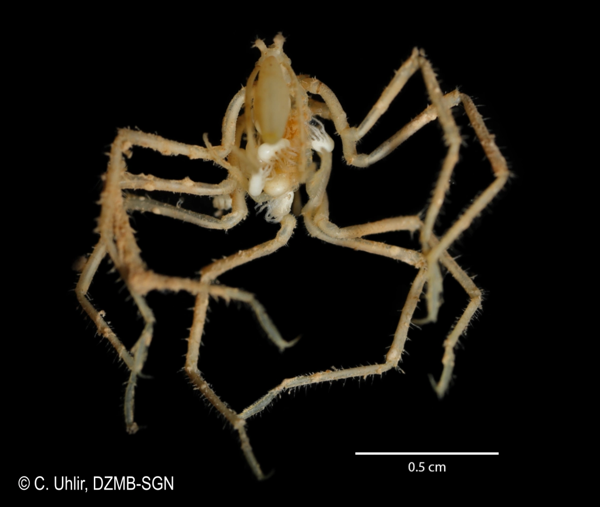

With Arctic ‘borealisation’, changes in the habitat preferences of shallow-water species from warmer waters are already being observed, but the effects on deep-sea fauna remain unknown. Recent studies highlight data gaps with regard to benthic biodiversity in deep Arctic waters. Sea spiders (Pycnogonida) are predatory representatives of the benthos and are more limited in their distribution potential compared to pelagic-dispersive species due to paternal brood care. Nevertheless, widespread species are present in shallow coastal regions (e.g. Pycnogonum litorale (STRØM, 1762)) as well as in deep-sea areas (e.g. Ascorhynchus abyssi SARS, 1877). 

{width="70%"}

Uhlir et al. are working on a current inventory of the taxonomic and genetic diversity of pycnogonids in boreal, Subarctic and Arctic waters. Initial results on actual species diversity and distribution showed: 

- Inconsistencies in identification were found due to sexual dimorphism or regional differences. 
- The majority of all taxonomic morphospecies correlate with the genetic results of DNA barcoding (COI).
- Selected species with a wide geographical distribution showed genetic species complexes. 
- Cryptic species were identified, particularly in the most species-rich genus Nymphon FABRICIUS, 1794. 

{width="70%"}

Typical distribution areas will be summarized for each species and linked to high-resolution biotope mapping from the MAREANO program to determine species- or community-specific habitat preferences. As part of our international collaboration, the dataset comprises various projects and expeditions (ALONGate, ArcWatch, IceAGE, MAREANO, LTER HAUSGARTEN, TUNU), enabling comprehensive geographical and bathymetric coverage. The findings of this study provide fundamental information for observing shifts in distribution with which sea spiders could respond to future changes in the ocean.

This study is in preparation to submission in 2027. Stay tuned!

