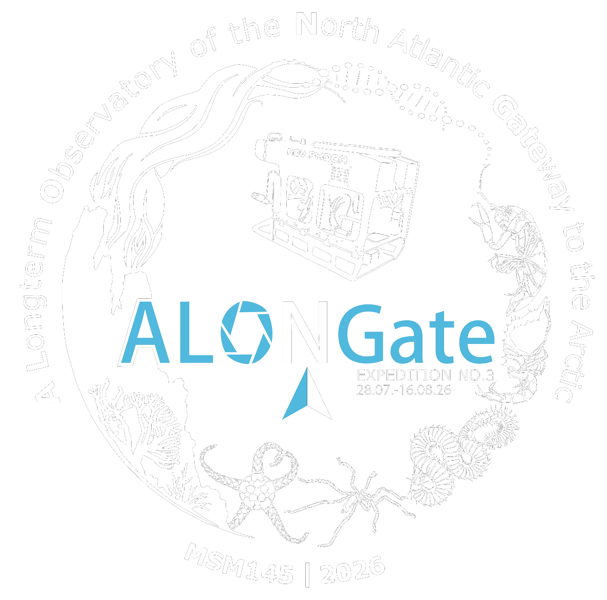

```{=html}
<!-- looping video background -->
<video autoplay loop muted playsinline class="bg-video">
    <source src="assets/vid/website_carousel.mp4" type="video/mp4">
</video>

<style>
    /* looping video background start */
    .bg-video {
        position: fixed;
        top: 0;
        left: 0;
        width: 100vw;
        height: 100vh;
        object-fit: cover;
        z-index: -2;
    }

    body::before {
        content: "";
        position: fixed;
        top: 0;
        left: 0;
        width: 100vw;
        height: 100vh;
        background: linear-gradient(rgba(51, 51, 51, 0.5), rgba(51, 51, 51, 0.5));
        z-index: -1;
    }

    body {
        background: transparent !important;
        font-family: system-ui, -apple-system, 'Segoe UI', Roboto, Helvetica, Arial, sans-serif;
        color: white !important;
        margin: 0;
        height: 100vh;          /* Locks the body to exactly the window height */
        overflow: hidden;       /* Disables overall page scrolling */
        /* display: flex; */
        /* flex-direction: column; Stacks the scroll container and new footer vertically */
        /* align-items: center;    Centers the containers horizontally */
    }

    /* New wrapper to bypass Quarto's structural tags */
    .fullscreen-wrapper {
        position: absolute;
        top: 0;
        left: 0;
        width: 100vw;
        height: 100vh;
        display: flex;
        flex-direction: column;
        align-items: center;
    }

    .main-scroll-container {
        width: 100%;
        flex-grow: 1;
        overflow-y: auto;
        display: flex;
        flex-direction: column;
        align-items: center;
    }

    .new-fixed-footer {
        width: 100%;
        flex-shrink: 0;
        background: transparent;
        padding: 15px 20px;
        text-align: center;
        font-size: 0.85rem;
        color: rgba(255, 255, 255, 0.8);
        border-top: 1px solid rgba(255, 255, 255, 0.1);
    }
    /* looping video background end */

    /* static image background start */
    /* body {
        background: linear-gradient(rgba(51, 51, 51, 0.5), rgba(51, 51, 51, 0.5)), url("./assets/img/_ZPA2002.jpg") no-repeat center center fixed;
        background-size: cover;
        font-family: system-ui, -apple-system, 'Segoe UI', Roboto, Helvetica, Arial, sans-serif;
        color: white;
        margin: 0;
        min-height: 100vh;
        display: flex;
        justify-content: center;
        align-items: flex-start;
    } */
    /* static image background end */

    .linktree-container {
        width: 100%;
        max-width: 450px;
        padding: 50px 20px;
        text-align: center;
    }

    .profile-pic {
        width: 300px;
        height: 300px;
        border-radius: 50%;
        object-fit: cover;
        border: 3px solid white;
        box-shadow: 0 4px 10px rgba(0,0,0,0.3);
        margin-bottom: 20px;
    }

    .project-title {
        font-size: 2rem;
        font-weight: bold;
        margin-top: 0;
        margin-bottom: 10px;
    }
    .project-desc {
        font-size: 1.1rem;
        margin-bottom: 40px;
        opacity: 0.9;
        line-height: 1.5;
    }

    .link-btn {
        display: flex;
        background-color: rgba(255, 255, 255, 0.15);
        color: white;
        text-decoration: none;
        padding: 8px 20px 8px 12px;
        min-height: 90px;
        margin-bottom: 16px;
        border-radius: 20px;
        font-size: 1.1rem;
        font-weight: 500;
        border: 1px solid rgba(255, 255, 255, 0.41);
        transition: all 0.3s ease;
        backdrop-filter: blur(10px);
        -webkit-backdrop-filter: blur(10px);
    }

    .link-btn:hover, .link-btn:active {
        background-color: white;
        color: #1e3c72;
        transform: translateY(-3px);
        box-shadow: 0 6px 15px rgba(0,0,0,0.2);
    }

    .btn-text {
        display: flex;
        flex-direction: column;
        justify-content: center;
        text-align: left;
        margin: 0;
        line-height: 1.1;
    }

    .btn-thumb {
        width: 70px;
        height: 70px;
        border-radius: 14px;
        object-fit: cover;
        margin-right: 20px; /* Space between image and text */
        flex-shrink: 0; /* Prevents the image from shrinking if text is long */
    }

    /* partner logo */
    .partners-container {
        width: 100%;
        max-width: 650px;
        display: flex;
        flex-wrap: wrap; /* Automatically pushes logos to a new row if they run out of space */
        justify-content: center;
        align-items: center;
        gap: 20px; /* Space between logos and rows */
        margin-top: 20px; 
        margin-bottom: 40px;
        padding-top: 30px;
        /* border-top: 1px solid rgba(255, 255, 255, 0.2); /* Subtle divider above logos */ 
    }

    .partner-link {
        display: inline-block;
        transition: transform 0.3s ease;
    }

    .partner-link:hover {
        transform: scale(1.05); /* Slight pop effect on hover */
    }

    .partner-img {
        /* Set your desired min and max heights here */
        min-height: 35px;
        max-height: 55px; 
        width: auto;
        object-fit: contain;
        opacity: 0.9;
        transition: opacity 0.3s ease;
    }

    .partner-link:hover .partner-img {
        opacity: 1;
    }

    .ctext-container {
        width: 100%;
        max-width: 450px;
        text-align: center;
    }

    .ctext-container-subtitle {
        width: 100%;
        max-width: 450px;
        margin-top: 20px;
        padding-top: 20px;
        text-align: center;
        font-weight: 550;
        font-size: 1.4rem;
    }
</style>
```

<!-- START FULLSCREEN WRAPPER -->
::::: {.fullscreen-wrapper}

:::: {.main-scroll-container}

<br><br>

::: {.linktree-container}

<!-- Replace 'logo.png' with your actual project logo or a nice icon -->
{.profile-pic}

::: {.project-title}
ALONGate
:::

::: {.project-desc}
<u>**A**</u> <u>**L**</u>ongterm <u>**O**</u>bservatory of the <u>**N**</u>orth Atlantic <u>**Gate**</u>way to the Arctic
:::

```{r}
#| output: false
#| echo: false
# config
library(tidyverse)

parse_links <- function(pmap_list) {
    parse_link <- function(thumb, text, url) {
        sprintf("[ {.btn-thumb} [%s]{.btn-text}](%s){.link-btn}", thumb, text, url)
    }
    md.parsed <- purrr::pmap(pmap_list, \(x, y){
        text <- zhutilsr::read_md_frontmatter(y) %>% yaml::yaml.load() %>% .$menutitle
        parse_link(x, text, y)
    })
    return(md.parsed)
}
```

```{r}
#| message: false
#| output: asis
#| warning: false
#| echo: false
# relative path to qmd file
url.project <- c(
    "chapter/research/kohlenbach-talk.qmd",
    "chapter/research/wcmb-poster.qmd"
)

# thumbnails
thumbs.project <- c(
    "assets/logo/wcmb.webp",
    "assets/logo/wcmb.webp"
)

cat(paste(parse_links(list(thumbs.project, url.project)), collapse = "\n\n"))
```

::: {.ctext-container-subtitle}
Project
:::

```{r}
#| message: false
#| output: asis
#| warning: false
#| echo: false
# relative path to qmd file
url.project <- c(
    "chapter/project/about.qmd",
    "chapter/project/team.qmd",
    "chapter/project/expeditions.qmd"
)

# thumbnails
thumbs.project <- c(
    "assets/img/map_alongate_cropped.png",
    "assets/img/msm145_sgn_team.webp",
    "assets/img/msm145_onboard.webp"
)

cat(paste(parse_links(list(thumbs.project, url.project)), collapse = "\n\n"))
```

::: {.ctext-container-subtitle}
Research
:::


```{r}
#| message: false
#| output: asis
#| warning: false
#| echo: false
# relative path to qmd file
url.research <- c(
    "chapter/research/blos.qmd",
    "chapter/research/benthic-survey.qmd",
    "chapter/research/arctic-cumacean.qmd",
    "chapter/research/new-old-isopods.qmd",
    "chapter/research/pycno.qmd"
)

# thumbnails
thumbs.research <- c(
    "assets/img/blos_infrontof_artreef.webp",
    "assets/img/rov/benthic_survey.webp",
    "https://upload.wikimedia.org/wikipedia/commons/f/f5/Diastylis_laevis.jpg?utm_source=de.wikipedia.org&utm_campaign=imageinfo&utm_content=thumbnail_unscaled",
    "assets/img/Disconectes Coxalis_19122_f_V_300925.webp",
    "assets/img/pycno_fig1.webp"
)

cat(paste(parse_links(list(thumbs.research, url.research)), collapse = "\n\n"))
```

::: {.ctext-container-subtitle}
Impact
:::

```{r}
#| message: false
#| output: asis
#| warning: false
#| echo: false
# relative path to qmd file
url.impact <- c(
    "chapter/impact/workshops.qmd",
    "chapter/impact/collaborations.qmd"
)

# thumbnails
thumbs.impact <- c(
    "assets/img/ocisopod-_ZZ87376-ZH.webp",
    "assets/img/MSM145_artificialreefprep.jpg"
)

cat(paste(parse_links(list(thumbs.impact, url.impact)), collapse = "\n\n"))
```

:::
<!-- linktree_container -->

::: {.ctext-container}
This project is supported by:
:::

```{r}
#| message: false
#| output: asis
#| warning: false
#| echo: false
# Partner logos

partner_logos <- c(
    "assets/logo/senckenberg.png",
    "assets/logo/leibniz.png",
    "assets/logo/dfg.png",
    "assets/logo/bmftr.png"
)

partner_urls <- c(
    "https://www.senckenberg.de/",
    "https://www.leibniz-gemeinschaft.de",
    "https://www.dfg.de/en",
    "https://www.bmftr.bund.de/DE/Home/home_node.html"
)

# HTML Generation function
parse_partner <- function(logo, url) {
    sprintf('[{.partner-img}](%s){.partner-link}', logo, url)
}

# Generate and print the Markdown layout
cat("::: {.partners-container}\n\n")

parsed_partners <- purrr::map2_chr(partner_logos, partner_urls, parse_partner)
cat(paste(parsed_partners, collapse = "\n\n"))

cat("\n\n:::\n")
```

::: {.ctext-container}
Collaboration partners:
:::

```{r}
#| message: false
#| output: asis
#| warning: false
#| echo: false
# Partner logos

partner_logos <- c(
    "assets/logo/uhh.png",
    "assets/logo/geomar.png",
    "assets/logo/awi.png",
    "assets/logo/Ifremer.webp",
    "assets/logo/mfri_white.webp"
)

partner_urls <- c(
    "https://www.biologie.uni-hamburg.de",
    "https://www.geomar.de",
    "https://www.awi.de",
    "https://www.ifremer.fr/fr",
    "https://www.hafogvatn.is/en/"
)

# Generate and print the Markdown layout
cat("::: {.partners-container}\n\n")

parsed_partners <- purrr::map2_chr(partner_logos, partner_urls, parse_partner)
cat(paste(parsed_partners, collapse = "\n\n"))

cat("\n\n:::\n")
```

```{=html}
<footer style="
    margin-top: 10px;     /* Space between the last button and the footer */
    padding-bottom: 30px;
    font-family: 'Arial', sans-serif; /* Keep Arial for legibility */
    color: #e4dddaff;
    font-weight: 200;
    opacity: 0.8;         /* Slightly brighter */
    text-align: center;    /* Aligns text to the right */
">
<p style="margin: 0; font-size: 0.7rem;">
    Site built with Quarto by <a href="https://zzzhehao.github.io/" style="color: inherit; text-decoration: underline;">Zhehao Hu</a>. <br>
    Source code available at <a href="https://github.com/zzzhehao/ALONGate_Project/" style="color: inherit; text-decoration: underline;">github.com</a>.
</p>
</footer>
```

::::

```{=html}
<div class="new-fixed-footer">
    <p style="margin: 0; font-weight: 200; font-size: 0.7rem;">Background video was recorded during MSM145 expedition by <i>ROV Phoca</i> © GEOMAR.</p>
</div>
```

:::::
